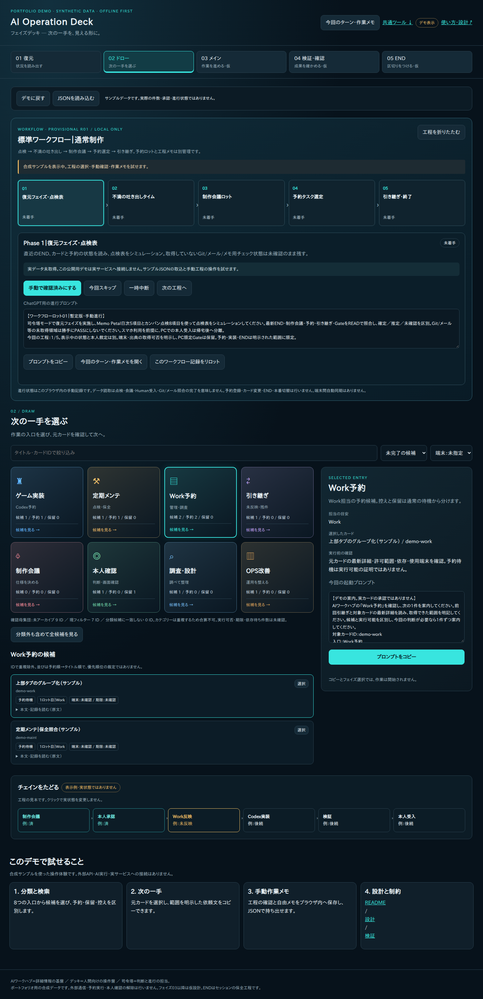

> 公開時追記（2026-11-01）：本人の公開指示により、この公開候補を creative-workflow-portfolio に収録しました。以下の公開前記録は準備時点の履歴です。配布ライセンスは未付与です。

# AI Operation Deck — Portfolio Demo

散らばった作業を「復元 → 選定 → 実行依頼 → 検証 → 引き継ぎ」の流れで整理する、ブラウザ用の操作盤デモです。実際の個人制作で使う画面から、合成サンプルだけで試せる部分を切り出しました。

## 30秒で試す

1. `index.html` をブラウザで開く。インストール・認証・API設定は不要です。
2. 「Work予約」などの入口を選び、カードの「選択」を押す。
3. 右側の依頼文を確認してコピーする。コピー操作ではAIやタスクは起動しません。
4. 「今回のターン・作業メモ」でメモを保存し、再読込して保持を確認する。

表示には合成9カードを使います。`sample.json` を「JSONを読み込む」から再取込できます。ブラウザのファイル保存制限がある場合は、公開予定ファイルだけのフォルダで `python3 -m http.server 18126 --bind 127.0.0.1` を実行し、表示されたポートのページを開いてください。Pythonは任意です。

## 解決したかった問題

AIを使う個人制作では、実装・調査・仕様相談・本人確認が並行し、「次に何をするか」「どこまで済んだか」が分かりにくくなりました。詳細カードを置き換えるのではなく、作業の入口と手動の進行記録を一画面へまとめる設計です。

## 機能

- 5フェイズ、8カテゴリー、名称/ID検索、予約・保留・控えの絞り込み。
- カード選択から範囲を明示した依頼文を作成。コピー不可時は手動選択へ切替。
- ID参照をたどる表示。参照関係を実行依存と自動判定しません。
- 手動工程チェック、自由メモ、ターン履歴、JSONの書出し/復元。
- PC/狭い画面向け表示、キーボードフォーカス、入力文字列の安全な表示。

## 技術と選択理由

HTML / CSS / JavaScriptのみ。ランタイム依存・外部CDN・ビルド工程はありません。依存を減らし、ファイルを開くだけで評価できる構成にしました。状態はDOMと小さなモデル関数で管理し、作業メモはlocalStorageへ保存します。別タブとの競合時は上書きを止めて再読込を促します。

## 本人とAIの役割

本人は利用上の課題、フェイズ構成、業務の区分、優先順位、承認範囲、表示改善の要望を決め、画面を確認しています。AI支援をコードの実装・試験・文書化に使用しています。本人が全コードを手書きしたという実績表現はしません。本デモの公開前の最終表示確認は別途必要です。

## 検証と制約

[検証結果](docs/VALIDATION.md)と[設計・制約](docs/DESIGN.md)を参照してください。開発用ブラウザテストはNode.jsとPuppeteerを使用します。利用者の通常操作には不要です。

このデモはAIエージェント、タスク実行器、バックエンド、クラウド同期を含みません。チェック済みは手動の工程記録であり、実タスクの完了や受入を保証しません。ブラウザデータ消去でメモが失われるため、継続利用時はJSONを書き出してください。JSON取込の内容は画面表示に使われ、ネットワークへ送信されません。

## 次の改善

分類の正式なメタデータ化、共通ダッシュボードの入口整理、取得版と受入根拠の表示改善を検討しています。本デモで未実装の機能を完成済みとは表現しません。

## 公開状況・ライセンス

公開準備版です。公開先と配布ライセンスは本人確認待ちです。現時点でオープンソースライセンスは付与していません。公開リポジトリへの掲載と再利用許諾は別です。[公開予定ファイル](docs/PUBLISHING.md)を確認してください。
